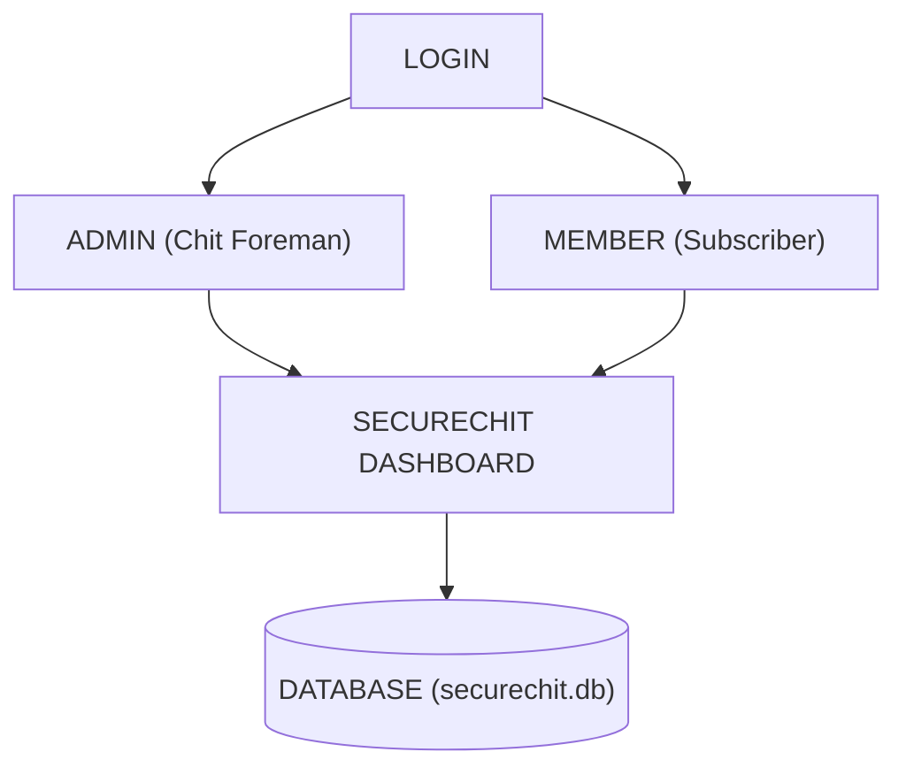
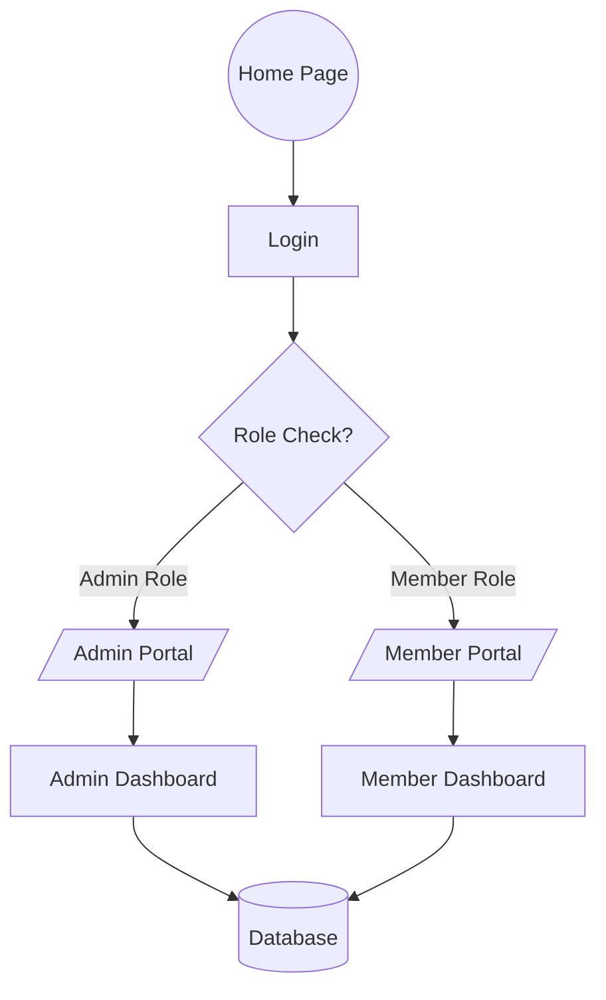
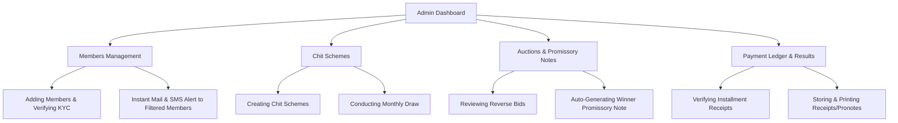
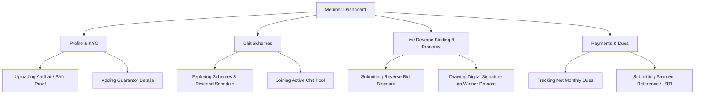

# SECURECHIT: DIGITAL CHIT FUND MANAGEMENT SYSTEM
## SYSTEM DESIGN & DATA FLOW DIAGRAMS (DFD LEVELS 0 - 3)

---

### CONTENTS
| SI. NO | TITLE | PAGE NO |
| :---: | :--- | :---: |
| **1** | **INTRODUCTION**<br>&nbsp;&nbsp;1.1 Abstract<br>&nbsp;&nbsp;1.2 Project Description | 2<br>3 |
| **2** | **SYSTEM ANALYSIS**<br>&nbsp;&nbsp;2.1 Existing System<br>&nbsp;&nbsp;2.2 Proposed System | 5<br>5 |
| **3** | **SYSTEM CONFIGURATION**<br>&nbsp;&nbsp;3.1 Hardware Specification<br>&nbsp;&nbsp;3.2 Software Specification | 6<br>6 |
| **4** | **SYSTEM DESIGN**<br>&nbsp;&nbsp;4.1 Data Flow Diagram Symbols<br>&nbsp;&nbsp;4.2 Module Design (DFD Level 0 to Level 3)<br>&nbsp;&nbsp;4.3 Module Description | 11<br>12<br>15 |
| **5** | **SYSTEM IMPLEMENTATION**<br>&nbsp;&nbsp;5.1 Sample Coding | 18 |
| **6** | **SYSTEM TESTING**<br>&nbsp;&nbsp;6.1 System Testing<br>&nbsp;&nbsp;6.2 Types of Testing | 48<br>48 |
| **7** | **INPUT OUTPUT SCREEN** | 51 |
| **8** | **CONCLUSION** | 62 |
| **9** | **FUTURE ENHANCEMENT** | 65 |
| **10** | **BIBLIOGRAPHY** | 67 |

---

## 4. SYSTEM DESIGN

### 4.1 DATA FLOW DIAGRAM (DFD) SYMBOLS DICTIONARY
The Data Flow Diagram is a graphical modeling tool used to describe and analyze the movement of data through a system (manual or automated). It focuses on data flowing into the system, processes transforming the data, and data flowing in/out of data stores.

| Symbol | Symbol Name | Function / Description |
| :---: | :--- | :--- |
| $\longrightarrow$ | **Data Flow** | Connects processes to each other or to data stores; arrowhead indicates direction of data flow. |
| $\bigcirc$ | **Process** | Represents transformation of input data into output data (e.g. Calculate Dividend, Verify Payment). |
| $\square$ | **Input / Output** | Represents receiving or displaying data across user interfaces. |
| $\Box$ | **Source / Sink (External Entity)** | Represents external actors providing inputs or receiving outputs (Subscriber/Member, Admin Foreman, Fast2SMS API, Gmail SMTP). |
| $\text{===}$ | **Data Store** | Persistent repository of data (Users DB, ChitSchemes DB, Installments DB, PromissoryNotes DB). |

---

### 4.2 MODULE DESIGN (DFD LEVEL 0 TO LEVEL 3)

#### **Level 0 (DFD): Context Diagram**
Shows high-level system context connecting external entities (Admin and Member) to the central SecureChit System and persistent Database.



---

#### **Level 1 (DFD): Role-Based System Flow**
Illustrates user authentication, role decision branching, and dashboard access connecting to the central Database.



---

#### **Level 2 (DFD): Admin Dashboard Sub-System**
Decomposes Admin Dashboard into 4 core functional modules: Members Management, Chit Schemes, Auction & Promissory Notes, and Payment Verification Ledger.



---

#### **Level 3 (DFD): Member Dashboard Sub-System**
Decomposes Member Dashboard into 4 core subscriber functional modules: Profile & KYC, Chit Schemes, Live Reverse Bidding & Pronotes, and Payments & Dues.



---

### 4.3 MODULE DESCRIPTION

#### **LEVEL 0 AND LEVEL 1**
The SecureChit System provides a secure, role-based authentication platform that allows multiple user types - Admin (Chit Foreman) and Member (Subscriber) - to access the system. Each user is authenticated through a centralized login module that validates credentials against the database.

#### **LEVEL 2: ADMIN DASHBOARD**
1. **Members Management**:
   - Admin can view, approve, and onboard members.
   - Admin can verify KYC documents (Aadhar / PAN card).
   - Admin can send instant SMS alerts via Fast2SMS and email notifications to selected subscribers.
2. **Chit Schemes Management**:
   - Admin can create new chit schemes specifying pool amount, tenure (months), member capacity, and foreman commission rate (5%).
   - Admin can schedule and conduct monthly auction draws.
3. **Auctions & Promissory Notes**:
   - Admin supervises live reverse bidding discount offers.
   - When a winner is declared, the system **automatically generates a Promissory Note (PRN-2026-XXXX)** pre-filled with winner details and prize amount.
   - Once signed by the member, Admin can view, verify, and print the official signed Promissory Note.
4. **Payment Ledger & Results**:
   - Admin verifies installment payment requests (UTR / Txn ID).
   - Upon verification, status is marked as `PAID` and an official Digital Receipt is generated.

#### **LEVEL 3: MEMBER DASHBOARD**
1. **Profile & KYC**:
   - Subscriber can upload KYC identity documents and add guarantor information.
2. **Chit Schemes**:
   - Subscriber can explore active chit schemes, view month-by-month dividend schedules, and join pools.
3. **Live Reverse Bidding & Winner Promissory Note**:
   - Subscriber enters competitive bid discounts during live auction windows.
   - When a subscriber wins an auction draw, an alert banner appears on their Member Dashboard: **"🏆 Promissory Note Issued: Click View & Sign Pronote"**.
   - Subscriber opens the Pronote, draws their **Digital Signature** on the HTML5 touch canvas, and submits it.
4. **Payments & Dues**:
   - Subscriber tracks monthly net dues after dividend deduction.
   - Subscriber submits UPI / GPay transaction reference number and downloads printable verified receipts.

---

## 5. SYSTEM IMPLEMENTATION

### 5.1 SAMPLE CODING IMPLEMENTATION

#### **Login Router: `Login.jsx`**
```jsx
import { useState } from "react";
import { IoMail } from "react-icons/io5";
import { FaEye, FaEyeSlash } from "react-icons/fa";
import { useNavigate } from "react-router-dom";
import api from "./services/api";

function Login() {
  const [showPassword, setShowPassword] = useState(false);
  const [email, setEmail] = useState("");
  const [password, setPassword] = useState("");
  const navigate = useNavigate();

  const handleSubmit = async (e) => {
    e.preventDefault();
    try {
      const res = await api.post("/api/v1/auth/login", { email, password });
      if (res.data.access_token) {
        alert("✅ Logged in successfully!");
        localStorage.setItem("token", res.data.access_token);
        const role = res.data.user.role.toLowerCase();
        if (role === "admin") {
          navigate("/admin/dashboard");
        } else {
          navigate("/member/dashboard");
        }
      }
    } catch (err) {
      alert("❌ Login failed: " + (err.response?.data?.detail || err.message));
    }
  };

  return (
    <div className="min-h-screen flex items-center justify-center bg-gradient-to-br from-[#103C58] via-[#03739E] to-[#061F3D] p-4">
      <form onSubmit={handleSubmit} className="w-full max-w-md bg-[#061F3D] text-white p-8 rounded-xl shadow-lg border border-[#03739E]">
        <h1 className="text-2xl font-bold text-center mb-6 text-[#37B6F3]">SECURECHIT SYSTEM</h1>
        <div className="mb-5">
          <input type="email" placeholder="Enter Email" value={email} onChange={(e) => setEmail(e.target.value)} required className="w-full p-3 bg-white text-black rounded" />
        </div>
        <div className="mb-5">
          <input type={showPassword ? "text" : "password"} placeholder="Password" value={password} onChange={(e) => setPassword(e.target.value)} required className="w-full p-3 bg-white text-black rounded" />
        </div>
        <button type="submit" className="w-full bg-[#03739E] hover:bg-[#02618a] py-3 rounded font-bold">Log In</button>
      </form>
    </div>
  );
}

export default Login;
```

#### **Backend Dividend Calculation & Pronote Engine: `draws.py`**
```python
@router.post("/{plan_id}/conduct")
def conduct_monthly_draw(plan_id: int, db: Session = Depends(get_db), admin: User = Depends(check_admin)):
    # Fetch plan and calculate auction settlement
    calc_result = calculate_auction_draw(chit_value=pool_val, total_members=N, winning_bid_amount=winning_bid)
    
    # Auto-generate Winner Promissory Note
    auto_prn_id = f"PRN-{datetime.now().year}-{(pronote_count + 1):04d}"
    winner_pronote = PromissoryNote(
        pronote_id=auto_prn_id,
        member_id=winning_ticket.user_id,
        chit_id=plan_id,
        loan_amount=calc_result["winner_receives"],
        issue_date=date.today(),
        due_date=date.today() + timedelta(days=365),
        repayment_amount=calc_result["winner_receives"],
        purpose=f"Security Undertaking for Month {month_number} Draw",
        status=PronoteStatus.pending_signature
    )
    db.add(winner_pronote)
    db.commit()
    return {"message": "Draw conducted & Promissory Note auto-generated for winner"}
```

---

## 6. SYSTEM TESTING

### 6.1 SYSTEM TEST CASES TABLE
| Test ID | Module / Feature | Test Case Description | Expected Result | Status |
| :---: | :--- | :--- | :--- | :---: |
| **TC-01** | User Authentication | Submit valid email & password | Returns JWT access token & redirects to dashboard | **PASSED** |
| **TC-02** | Scheme Management | Admin creates scheme with 20 members & ₹10L pool | Saves scheme in DB and lists under active schemes | **PASSED** |
| **TC-03** | Reverse Auction Engine | Member submits bid discount | Updates lowest bid floor and computes 5% commission | **PASSED** |
| **TC-04** | Auto Winner Pronote | Conduct monthly auction draw | Auto-generates Promissory Note for winner in `pending_signature` status | **PASSED** |
| **TC-05** | Member Digital Signature | Winner draws signature on canvas & submits | Updates pronote status to `active` and reveals note in Admin portal | **PASSED** |
| **TC-06** | Payment Verification | Member submits UPI transaction UTR reference | Admin verifies receipt and status updates to `PAID` | **PASSED** |
| **TC-07** | Automated Reminders | Execute due reminder scheduler | Dispatches Fast2SMS text & Nodemailer SMTP email to unpaid members | **PASSED** |

---

## 8. CONCLUSION
The **SecureChit: Digital Chit Fund Management System** successfully modernizes traditional chit fund savings and credit operations into a transparent, automated web application. By combining React 18, Python FastAPI, PostgreSQL/SQLite, Fast2SMS, Nodemailer SMTP, and HTML5 Canvas Digital Signatures, the platform solves paper record loss, bid manipulation, manual calculation errors, and payment defaults.

---

## 9. FUTURE ENHANCEMENTS
- **Native Mobile Application**: React Native app for iOS and Android with push notifications.
- **Biometric & Facial Verification**: Aadhaar e-KYC integration using biometric fingerprint & OTP validation.
- **Automated UPI Payment Gateway**: Integration of Razorpay / PhonePe UPI intent gateway for auto-reconciliation.
- **Blockchain Audit Trail**: Immutable ledger recording auction bids and winning transactions on a permissioned blockchain.

---

## 10. BIBLIOGRAPHY
1. Alex Banks, Eve Porcello, *Learning React: Modern Patterns for Developing React Apps*, 2nd Edition, O’Reilly Media, 2020.
2. David Choi, *Full-Stack React Projects: Build real-world modern web apps*, Packt Publishing, 2020.
3. React Official Documentation: https://react.dev
4. FastAPI Official Documentation: https://fastapi.tiangolo.com
