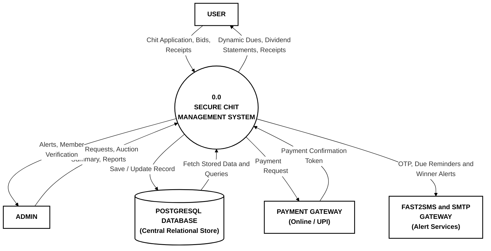
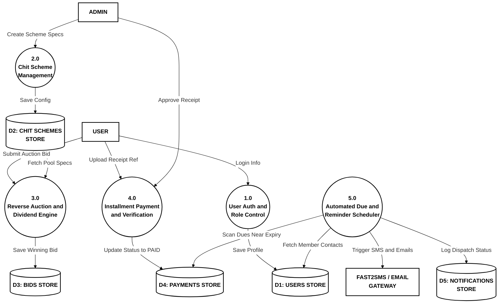
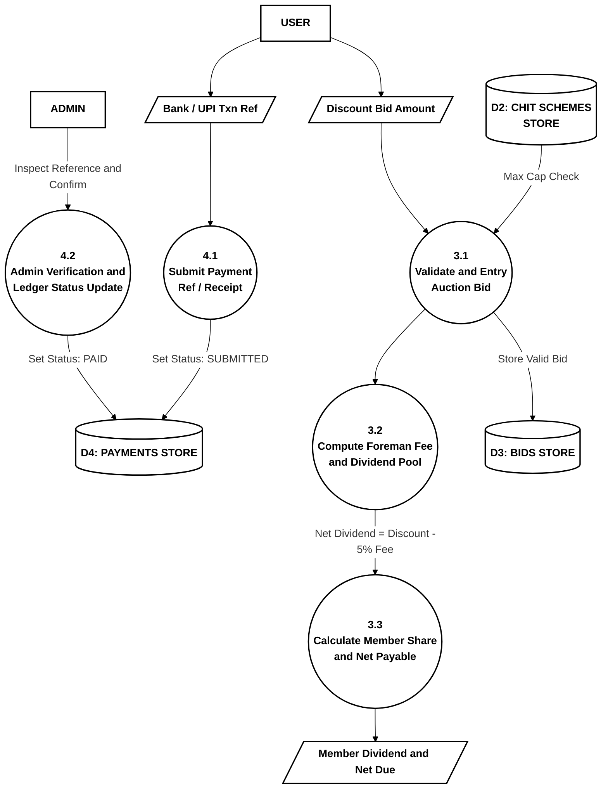
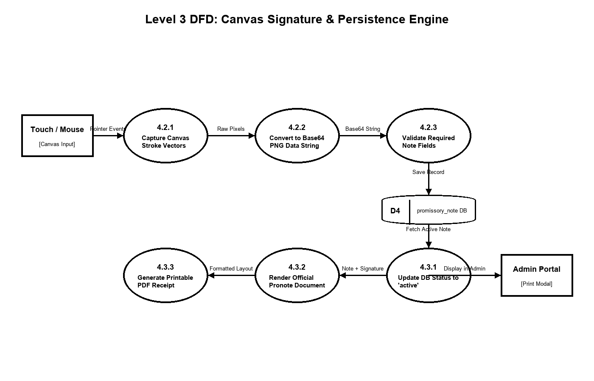

# SECURE CHIT: DIGITAL CHIT FUND MANAGEMENT SYSTEM

**Submitted in partial fulfilment of the requirements for the award of the degree of**  
**Bachelor of Science in Computer Science**

---

### Submitted By:
- **R. NARESHKUMAR** (Reg No: 24UCS08)
- **APR. JEGATHEESH VARSHAN** (Reg No: 24UCS06)

### Under the Guidance of:
- **Mrs. SM. VALLI B.E., M.C.A., M.Phil**

---

### DEPARTMENT OF COMPUTER SCIENCE  
**THIAGARAJAR COLLEGE (AUTONOMOUS)**  
*(Affiliated to Madurai Kamaraj University)*  
*Re-accredited with 'A++' Grade by NAAC | Ranked 20th in NIRF 2026*  
**Madurai – 625009**  
**October - 2026**

---

## BONAFIDE CERTIFICATE

This is to certify that the project work entitled **"SECURE CHIT: DIGITAL CHIT FUND MANAGEMENT SYSTEM"** is a bonafide work done by **R. NARESHKUMAR (24UCS08)** and **APR. JEGATHEESH VARSHAN (24UCS06)** in partial fulfilment of the requirements for the award of the degree of **Bachelor of Science in Computer Science** during the academic year 2026.

Submitted for the final Viva-Voce Examination held on `_____________________` at Department of Computer Science, Thiagarajar College (Autonomous), Madurai - 625009.

**Project Guide & HOD:**  
Mrs. SM. VALLI B.E., M.C.A., M.Phil  
Head of the Department, Department of Computer Science  

---

## TABLE OF CONTENTS

1. **Intro & Overview**
2. **System Analysis**
3. **System Configuration**
4. **System Design (DFD Levels 0 - 3)**
5. **System Implementation**
6. **System Testing**
7. **Screenshots & Walkthrough**
8. **Conclusion**
9. **Future Enhancements**
10. **Bibliography & References**

---

## 1. Intro & Overview

### 1.1 Abstract

> **Title: Secure Chit Fund Management System.**  
> 
> **Paragraph 1**:  
> The Secure Chit Fund Management System is a web based financial management application designed to automate traditional chit fund operations with complete transparency and security. The system features a Razorpay payment gateway for online installment payments with instant printable Digital Receipts, an AI-powered smart winner allocation engine that evaluates emergency priorities to select auction winners fairly, and Role-Based Access Control (RBAC) web portals for members and administrators with full ledger auditability.
> 
> **Paragraph 2**:  
> Built using a modern full-stack web architecture leveraging React 18, Tailwind CSS, Python FastAPI REST services, and PostgreSQL database persistence, the system digitizes member onboarding, KYC validation, live reverse auction bidding, and automated dividend distribution. A core highlight of the platform is the integrated Promissory Note (Pronote) Management module. When an auction winner is announced, the system automatically generates an official legal Promissory Note (`PRN-YYYY-XXXX`) in pending status and requires the winner to draw their digital signature using an interactive HTML5 Canvas touch/mouse pad before the note is activated and revealed in the Administrator portal.
> 
> **Paragraph 3**:  
> To ensure operational reliability and zero payment defaults, SecureChit incorporates an automated multi-channel communication engine featuring Fast2SMS Bulk SMS and Nodemailer SMTP email integration for pre-due installment reminders and win declarations. Comprehensive security is maintained through bcrypt password encryption, JWT bearer session tokens, strict input validations, and immutable database audit trails. Overall, the platform eliminates physical paperwork, prevents bid collusion and ledger discrepancies, and delivers a transparent, automated, and legally auditable ROSCA solution for contemporary financial management.

---

### 1.2 Project Description
Chit funds represent a unique indigenous financial institution in India that combines savings and credit. SecureChit automates member onboarding, live reverse bidding, 5% foreman commission & dividend calculation, Promissory Note digital signatures, and automated payment tracking.

---

## 2. System Analysis
- **Existing System**: Manual ledgers, physical paper bidding, paper promissory notes, and payment default risks.
- **Proposed System**: Cloud-based web portal with live reverse auction engine, HTML5 canvas signature pad, automated receipt generation, and SMS/Email reminders.

---

## 3. Data Flow Diagrams (DFD)

### Level 0 Context Diagram

### Level 1 Subsystem Decomposition

### Level 2 Functional Breakdown

### Level 3 Detailed Subsystem Data Flow

